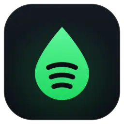
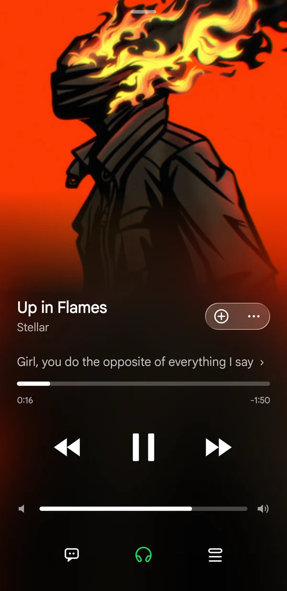
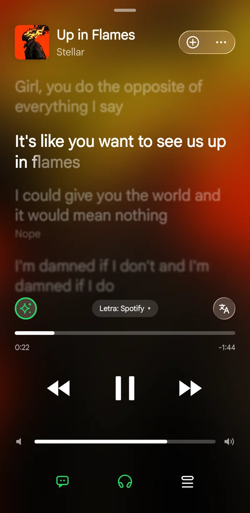
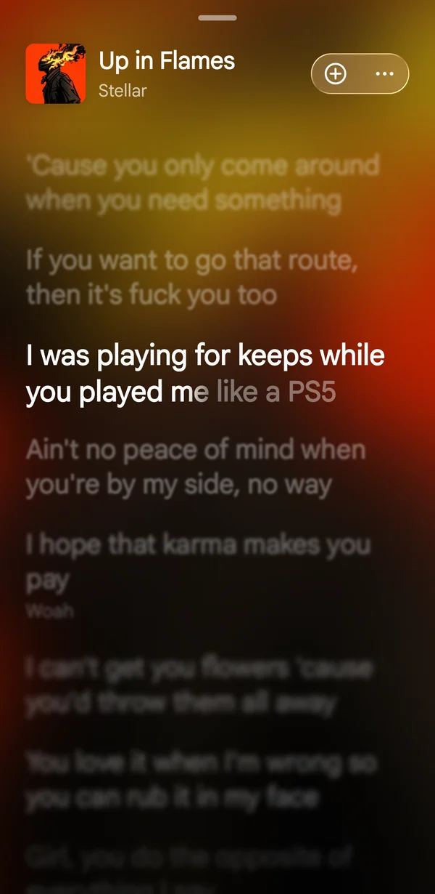
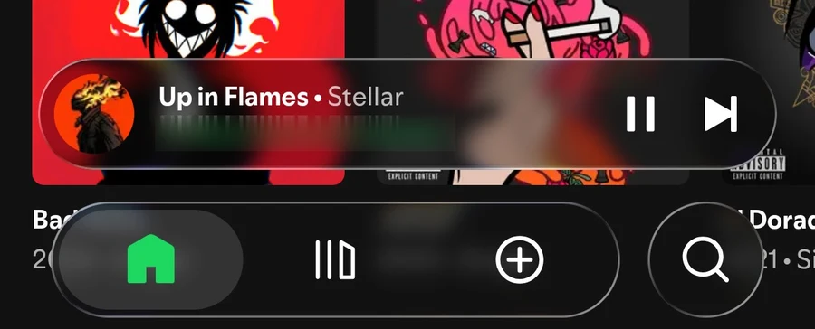
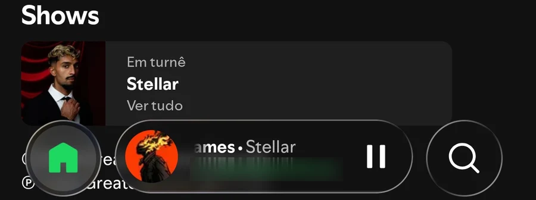

# LiquidSpot

### Make your favorite music app more Liquid

An LSPosed module that brings an iOS 26 inspired look, a new full-screen player and next-level synced lyrics to Spotify.

[**Download**](../../releases/latest) · [Screenshots](#screenshots) · [Features](#features) · [Install](#install) · [Credits](#credits)

---

## Screenshots

  
  
  
   
  Player · Synced lyrics · Lyrics in focus

  
  
   
  Glass bar and mini player · Shrunk on scroll

## Features

### 🫧 Liquid Glass everywhere
- **Navigation bar** — a floating glass pill with three layouts (three tabs, Search apart, or Create apart).
- **Glass lens** — hold and drag across the tabs to lift a lens that magnifies and refracts what's under it.
- **Shrink on scroll** — scrolling down turns the tabs into a circle and tucks the mini player into the bar, just like iOS 26.
- **Mini player** — a glass pill, with an optional compact mode (cover, song, pause and next).
- **Glass sheets and dialogs** — Connect, the "…" menus and dialogs get a blurred backdrop.
- **Four styles** — Liquid (blur + lens refraction), Frosted, Matte and Solid.

### 🎵 A brand new player
- Full-screen, iOS 26 style, with the cover blurred in the background.
- The song's **Canvas** video behind the controls (or turn it off and keep the cover).
- Drag down to dismiss, glass buttons, and a **volume bar** that also works with Spotify Connect.
- Shuffle, repeat, go to album and go to artist in the "…" menu.
- Optional **lyric line** above the progress bar, animated as the song moves on.

### 🎤 Lyrics, done right
- **14 sources** searched at once, in the order you choose.
- **Syllable karaoke** on sources that support it.
- **Duets** on each side, smaller **background vocals**, and dots for **instrumental breaks**.
- Controls **fade away** while you read; tap to bring them back.
- **Translate** any song to your device language.
- **AI syllable sync** (optional download) — listens to the song on your device and times line-synced lyrics syllable by syllable, using wav2vec2. Audio never leaves your phone.

### 🎨 Make it yours
- **AMOLED theme** — Spotify's dark greys become pure black.
- **Accent color** — swap Spotify's green for a preset or any `#RRGGBB`.
- **Keep Spotify running** — music keeps playing after clearing Spotify from recent apps.

## Requirements

- Android 12 or newer, rooted.
- LSPosed with the modern API (libxposed API 102).
- Spotify from the Play Store or the official APK. Tested on **9.2.0** and **9.2.2**.

## Install

1. Download the latest APK from [Releases](../../releases/latest) and install it.
2. Enable **LiquidSpot** in LSPosed Manager. Spotify is already in the scope.
3. Force stop Spotify and open it again. You should see "LiquidSpot active".
4. Open the settings from the module's settings button in LSPosed.

## Warnings

> [!WARNING]
> LiquidSpot only changes looks and UX.

> [!NOTE]
> LiquidSpot is inspired by [spoti.pw](https://github.com/skopevoj/spoti.pw) for iOS. It's an independent Android implementation and contains none of its code.

## Privacy

LiquidSpot has no analytics and no account. It only goes online for:
- **Lyrics** — title, artist, album and duration are sent to the lyrics sources you enable.
- **Translation** — the lyric lines are sent to Google Translate, only when you tap Translate.
- **AI sync** — the model and engine are downloaded from Hugging Face and Maven Central, only when you tap Download.

## Credits

Built on the shoulders of:
- [BitChord](https://github.com/kushagrasinghx/BitChord) — glass, floating bar and lyrics ideas.
- [Kyant0/Backdrop](https://github.com/Kyant0/AndroidLiquidGlass) — lens and rim shaders.
- [SpotifyPlus](https://github.com/Xposed-Modules-Repo/com.lenerd46.spotifyplus) — skeleton and inspiration.
- [wav2vec2-base-960h](https://huggingface.co/facebook/wav2vec2-base-960h) and [ONNX Runtime](https://onnxruntime.ai) — AI syllable sync.

Full credits and third-party licenses are in [NOTICE.md](NOTICE.md).

## License

LiquidSpot is free software under the [GNU General Public License v3.0](LICENSE).

LiquidSpot is not affiliated with, endorsed by or connected to Spotify AB or Apple Inc. Liquid Glass is Apple's design language; LiquidSpot only takes inspiration from it.

